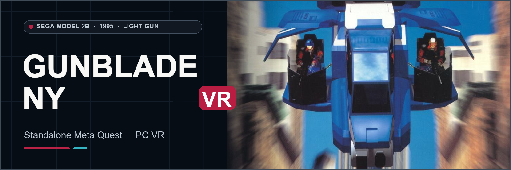

# Gunblade NY VR
### Sega Model 2B Arcade Light-Gun Action · Standalone Meta Quest & PC VR

**[Download the Quest APK, Windows OpenXR build, source and checksums](https://github.com/vr4all-standalone/gunblade-ny-vr/releases/tag/v0.1.8-beta)**

**[🌐 VR4ALL — Standalone VR Mod Installer](https://github.com/vr4all-standalone/vr4all-standalone)**  
**[☕ Donate to VR4ALL](https://ko-fi.com/vr4all)**

---

## The port

Gunblade NY VR brings Sega's original helicopter light-gun game into stereo VR with head tracking and tracked guns. It runs locally on Quest 3/3S; a Windows OpenXR build is available in the release. The original game's scenery, audio and rules come from your own game data.

The port has been played on a Quest 3S with stereo scenery, audio, tracked guns, haptics and two-player hand ownership. It supports the original automatic-fire trigger, native targeting rings in the world, optional hollow-X crosshairs, and the VR4ALL settings menu. Click the right thumbstick to switch the laser and crosshair off or on together; switching them back on restores your chosen crosshair style.

## Your game files

Bring your own **Gunblade NY Revision A** arcade data. The verified set is `gunblade.zip` with all 18 required payloads. A split set may also need `segabill.zip` in the same folder. No CHD is required. VR4ALL validates the actual files; game data is not included in this repository or its downloads.

## Install

Use [VR4ALL](https://github.com/vr4all-standalone/vr4all-standalone/releases) to choose your own `gunblade.zip`, download this port's Quest APK and transfer the game files. A split set may also need `segabill.zip`. Open **Gunblade NY - VR4ALL** on the Quest and finish its ROM validation before playing. For Windows OpenXR, extract the PCVR ZIP, put your owned archives in its `roms` folder, and run `run-pcvr.cmd`.

## Development notes

The Quest app name is **Gunblade NY - VR4ALL**. Quest 3S gameplay has been tested. The new paired shortcut has automated persistence and control tests; this release's shortcut, Quest 3 hardware and Windows OpenXR hardware have not had a physical play check. Some heavy scenes can run below full arcade speed. This is an independent fan project, not affiliated with Sega or Meta.

[Original flyer and banner attribution](docs/github/ARTWORK.md)
